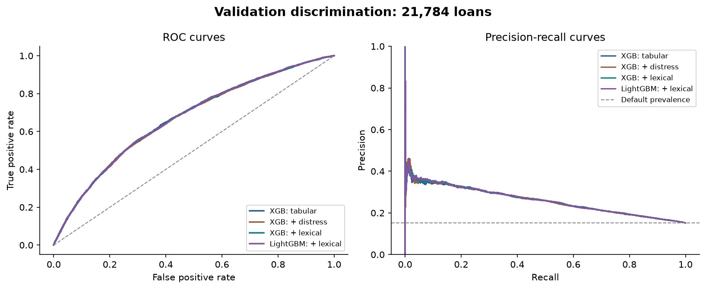
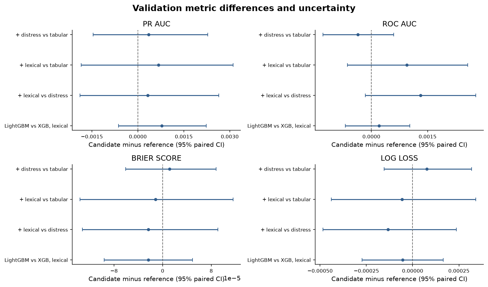
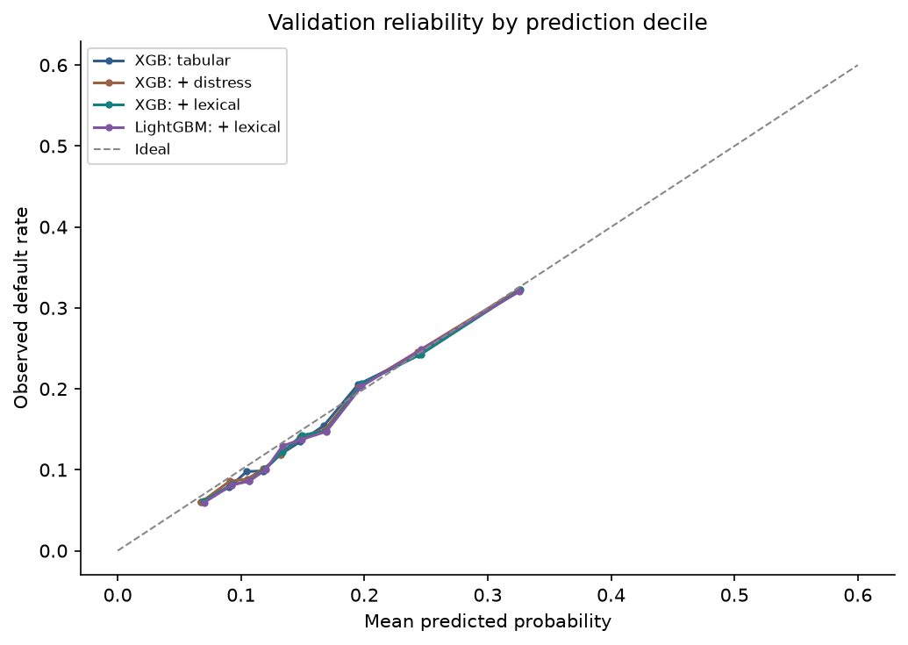

# Early feature fusion for credit risk prediction

**Research question:** Do lexical features add useful information to the approved tabular model, and does a second gradient boosting method improve the comparison?

**Owner:** Zheng Wei

**Cohort:** LendingClub `real_text_matured_v1`, frozen `split-v1`
**Status:** Development analysis; the final test remains sealed.

## Abstract and recommendation

Four models were compared on 21,784 validation loans: the approved nine-feature XGBoost baseline; the same XGBoost with description-only distress density; XGBoost with the full selected lexical set; and LightGBM with that same lexical set. All models used 59,353 earlier base-fitting loans, identical validation loans, and the existing time-ordered folds. The shared loan-role mapping was checked against the development manifest and its published checksum.

The full lexical XGBoost model increased validation ROC-AUC from 0.66644 to 0.66739 and PR-AUC from 0.25899 to 0.25966. Its paired 95% intervals against the baseline include zero for both ranking measures and both probability measures. LightGBM with lexical inputs achieved ROC-AUC 0.66759 and PR-AUC 0.26044, but its paired differences against lexical XGBoost also have intervals spanning zero. The available evidence does not establish a practically meaningful advantage for either additional lexical inputs or the selected LightGBM configuration. Retain the simpler nine-feature XGBoost as the reference for this experiment, rather than promote a more complex input set or algorithm on these results alone.

This recommendation concerns the variants tested here. The expanded lexical set and LightGBM challenger were added after the initial two-model validation results had been reviewed, so their findings are exploratory. The previous project-level champion decision remains separate; this study does not establish that XGBoost should replace the calibrated logistic-regression reference.

## 1. Experimental design

| Model | Tabular inputs | Lexical inputs | Learning algorithm |
| --- | --- | --- | --- |
| Tabular baseline | Nine approved features | None | XGBoost |
| Description distress | Same nine | Description-only distress density | Same XGBoost configuration |
| Full lexical | Same nine | Description-only density plus five lexical measures | Same XGBoost configuration |
| LightGBM challenger | Same nine | Same six lexical measures | LightGBM |

The approved features are loan amount, term, log annual income, debt-to-income ratio, revolving utilization, recent delinquencies, recent inquiries, credit history length and home ownership. The expanded lexical set contains `desc_distress_keyword_density`, `flesch_reading_ease`, `flesch_kincaid_grade`, `lexical_diversity_ttr`, `sentiment_polarity` and `sentiment_subjectivity`. The older combined `financial_distress_keyword_density` is deliberately excluded. “Full lexical” means this explicitly enumerated set, not every conceivable textual feature.

The density is calculated from cleaned **description text only**. Reading ease, grade level, type-token ratio, polarity and subjectivity come from the existing cleaned **title, purpose and description payload**. They can therefore capture title or purpose information as well as prose. Type-token ratio is sensitive to text length; reading ease and grade level are related formulae. A joint gain would not identify which feature caused it.

The same 59,353 base-fitting loans from June 2007 to December 2012 were used for every model. Five expanding-window folds, with whole issue months kept together, were used within that pool. Each final model was fitted on the entire base-fitting pool and evaluated on the same 21,784 loans issued from August to December 2013. The validation sample contains 3,298 defaults, or 15.14%. No fusion-fitting or fusion-calibration loans were used to fit these models, and the locked final test was not evaluated.

The new shared mapping from Brandon's `feature/fusion-development-roles` branch was read directly and checked against its published SHA-256 and every development manifest ID, original split and issue month. Its base-fitting and validation IDs matched the model inputs. The published PR was open when checked; the evidence here does not depend on assuming a merge. A mapping is a coordination and integrity check, not a new train/test split.

## 2. Validation performance

PR-AUC is average precision. Higher PR-AUC and ROC-AUC are better; lower Brier score and log loss are better. All scores below are raw model probabilities without post-hoc calibration.

| Model | PR-AUC | ROC-AUC | Brier score | Log loss |
| --- | ---: | ---: | ---: | ---: |
| XGBoost: nine tabular | 0.258987 | 0.666440 | 0.122375 | 0.402874 |
| XGBoost: plus description distress | 0.259344 | 0.666078 | 0.122387 | 0.402951 |
| XGBoost: full lexical set | 0.259662 | 0.667387 | 0.122363 | 0.402818 |
| LightGBM: full lexical set | 0.260439 | 0.667591 | 0.122340 | 0.402764 |

The absolute differences are small. Average precision is above the 0.1514 default prevalence for all four models, but this does not by itself show that text features add value. LightGBM has the highest point estimates for ranking and the lowest point estimates for probability losses in this sample. The paired intervals below do not establish a reliable advantage.



The precision-recall curve sweeps across prediction-score thresholds; no single decision threshold was chosen for this analysis. The curve is volatile close to zero recall because only a few top-ranked loans are selected. The plotting convention also adds the endpoint precision 1 at recall 0, where no loans are selected. This endpoint is not a measured performance level. For all four models, the single highest-scored validation loan was not a default; among the five highest-scored loans, the models identified two to four defaults. These very small denominators make the left edge jump sharply. Average precision summarizes performance across the full recall range, but practical use also requires a separately selected operating threshold.

### Paired differences and uncertainty

Each cell reports candidate minus reference, followed by its 95% paired percentile bootstrap interval. A positive difference is favorable for PR-AUC and ROC-AUC; a negative difference is favorable for Brier score and log loss.

| Comparison | PR-AUC difference (95% CI) | ROC-AUC difference (95% CI) | Brier difference (95% CI) | Log-loss difference (95% CI) |
| --- | --- | --- | --- | --- |
| Distress XGBoost minus tabular | +0.000356 (-0.001456, +0.002285) | -0.000363 (-0.001294, +0.000593) | +0.000012 (-0.000061, +0.000088) | +0.000077 (-0.000154, +0.000318) |
| Lexical XGBoost minus tabular | +0.000675 (-0.001853, +0.003106) | +0.000947 (-0.000643, +0.002568) | -0.000012 (-0.000136, +0.000116) | -0.000057 (-0.000440, +0.000342) |
| Lexical XGBoost minus distress XGBoost | +0.000319 (-0.001889, +0.002640) | +0.001309 (-0.000159, +0.002788) | -0.000023 (-0.000132, +0.000091) | -0.000133 (-0.000485, +0.000236) |
| Lexical LightGBM minus lexical XGBoost | +0.000776 (-0.000633, +0.002230) | +0.000203 (-0.000696, +0.001029) | -0.000024 (-0.000096, +0.000049) | -0.000053 (-0.000273, +0.000165) |



The intervals are based on 1,000 paired row bootstrap samples, using the same resampled loans for both models, with seed 42. They are conditional on the fitted models and do not incorporate uncertainty from refitting, feature selection or model selection. Rows may be correlated within issue months, so row-level intervals may understate uncertainty across time periods. An interval spanning zero does not prove equivalence. No practical equivalence margin was prespecified for this early-fusion comparison, and the multiple comparisons are not adjusted for multiplicity.

### Probability quality

The observed validation default rate is 15.14%. Mean raw predictions are 15.92% for the tabular XGBoost, 15.92% for distress XGBoost, 16.10% for lexical XGBoost and 16.12% for lexical LightGBM. These averages do not by themselves prove calibration at individual risk levels. The chart groups each model's predictions into ten quantile bins, so bins need not contain the same loans across models; it is a descriptive reliability assessment, not a calibration test.



## 3. Time-ordered cross-validation and sparsity

| Model | Mean fold PR-AUC | Mean fold ROC-AUC | Mean fold Brier | Mean fold log loss |
| --- | ---: | ---: | ---: | ---: |
| XGBoost: nine tabular | 0.271820 | 0.662968 | 0.130210 | 0.422371 |
| XGBoost: plus description distress | 0.271994 | 0.663381 | 0.130168 | 0.422232 |
| XGBoost: full lexical set | 0.272547 | 0.664799 | 0.130105 | 0.421965 |
| LightGBM: full lexical set | 0.273567 | 0.664239 | 0.130081 | 0.421965 |

These are unweighted averages of five fold-level metrics, not scores on pooled predictions. Differences are modest relative to variation among time periods and should not be treated as independent validation evidence for a model chosen after inspecting validation results.

Only 814 validation descriptions (3.74%) have a positive distress density. Among these, 143 loans defaulted. In the earlier two-model diagnostic, distress-only XGBoost increased PR-AUC from 0.30088 to 0.30641 within the keyword-positive subset, but that subgroup has no reported confidence interval and was examined after the run. It cannot support a claim of benefit. The zero-density group includes both descriptions with no listed keyword and descriptions with no usable words. Exact token matching can miss indirect distress or count a negated word; the result does not rule out other text representations.

## 4. XGBoost and LightGBM: interpretation of the challenger

Both methods build an ensemble of decision trees sequentially to reduce prediction error and can model nonlinear interactions. XGBoost commonly grows trees level by level subject to depth and regularization constraints. LightGBM uses leaf-wise growth, selecting the leaf with the greatest estimated gain, and uses histogram-based split finding. These choices can produce different trees even for similar depth limits. This study uses a depth limit of two and at most four leaves for LightGBM; its configuration is conservative and fixed, not an exhaustive search. Both pipelines share the same tabular preprocessing and lexical inputs, but algorithm-specific defaults and regularization differ. See the original [XGBoost paper](https://arxiv.org/abs/1603.02754) and [LightGBM paper](https://proceedings.neurips.cc/paper/2017/hash/6449f44a102fde848669bdd9eb6b76fa-Abstract.html).

In validation, lexical LightGBM's ROC-AUC exceeds lexical XGBoost by 0.000203 (95% CI -0.000696 to +0.001029), its PR-AUC exceeds it by 0.000776, and its log loss is lower by 0.000053. All three paired intervals span zero. LightGBM is a reasonable candidate for further investigation using time-ordered development data and separately specified settings, but its small observed gains do not justify replacing the reference on current evidence. The comparison supports the narrower conclusion that these **particular configurations** perform similarly on this period, within the study's uncertainty. It does not prove the algorithms equivalent or establish which would win under separate, carefully time-tuned searches. The LightGBM and expanded-lexical configurations were introduced after the initial validation review, so a later untouched evaluation is required before a promotion decision.

## 5. Investigation of the earlier cross-validation discrepancy

The earlier Windows XGBoost search reported a selected-model mean fold ROC-AUC of 0.661729. The present macOS run reports 0.662968, a difference of +0.001238. The original two-model run and this expanded run produced **identical baseline ROC-AUC values in all five folds** on the same Mac. The historical and current records use the same selected parameter values and fold sizes and date boundaries. The relevant tracked loader, evaluation, XGBoost and configuration files match the earlier XGBoost branch, the split-manifest Git blob matches, and the raw source CSV checksum matches the frozen source. These checks do not demonstrate byte-identical intermediate transformed features on the earlier machine.

The historical run used Windows AMD64 with Python 3.13.15; this run uses macOS arm64 with Python 3.13.2. Both report the same pinned modeling package versions. On the same 21,784 validation IDs, the mean absolute difference between saved historical baseline probabilities and this run's baseline probabilities is 0.003683, with a maximum of 0.044794. The observed discrepancy is therefore in fitted predictions as well as the reported cross-validation metric. Platform, Python patch version, native libraries or other execution differences are possible explanations, but they have not been isolated experimentally. Do not attribute the discrepancy to a particular cause without a controlled reproduction in the original environment. The earlier project [XGBoost PR](https://github.com/Evannoshy/instant-checkout-credit-engine/pull/17) also records sensitivity to package versions in a different earlier rerun, which is relevant context rather than proof of this discrepancy's cause.

## 6. Limitations, handoff and reproduction

The target and population are a historical LendingClub proxy and should not be represented as checkout or BNPL performance. Only one later five-month validation window was examined. Earlier project work used validation in development; final model selection requires the untouched final test and the agreed approval process. The availability of borrower descriptions at the actual decision time also needs confirmation.

The `nlp-desc-distress-v1` feature counts exact distress-keyword tokens divided by cleaned description word tokens. An unusable or zero-word description receives 0.0, which is also a valid value for a usable description with no listed keyword. A missing or mismatched feature join is an error and is never filled with zero. Vincent's earlier scorer does not expose an empty-description indicator; the shared missing-text fallback definition is a separate integration decision.

Use Python 3.13, the project's pinned tabular packages and LightGBM 4.7.0. With the raw source, feature exports and published mapping available, run:

```sh
python -m src.tabular.expanded_lexical_ablation
python -m src.tabular.plot_expanded_lexical
```

The [metrics](../reports/tabular/expanded_lexical_metrics.csv), [paired differences](../reports/tabular/expanded_lexical_deltas.csv) and [metadata](../reports/tabular/expanded_lexical_metadata.json) record the calculations, folds, parameters, checksums and environment. Validation predictions are written locally for reproducibility; they contain loan IDs and labels and require appropriate data handling. The expanded design followed the initial comparison; the exploratory OOF handoff was not used.
