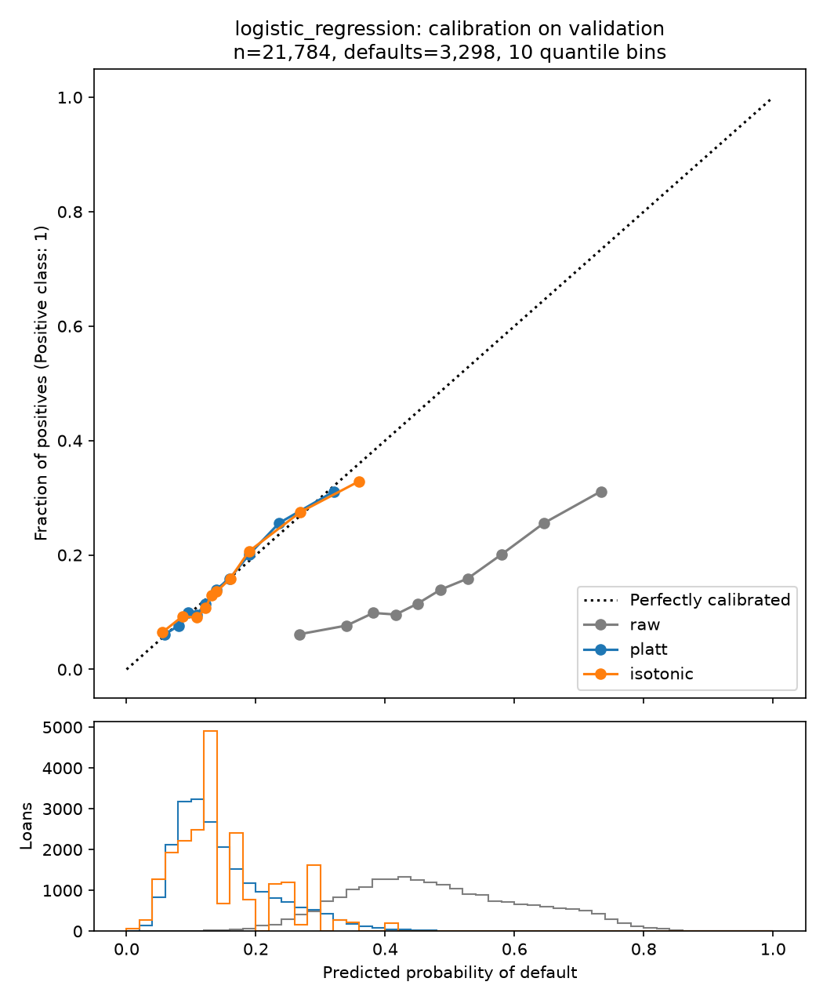
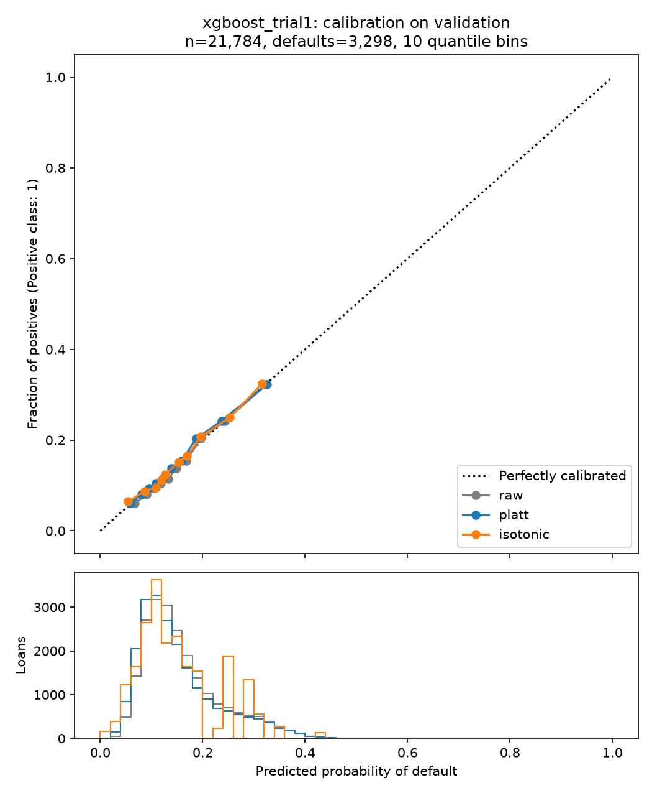
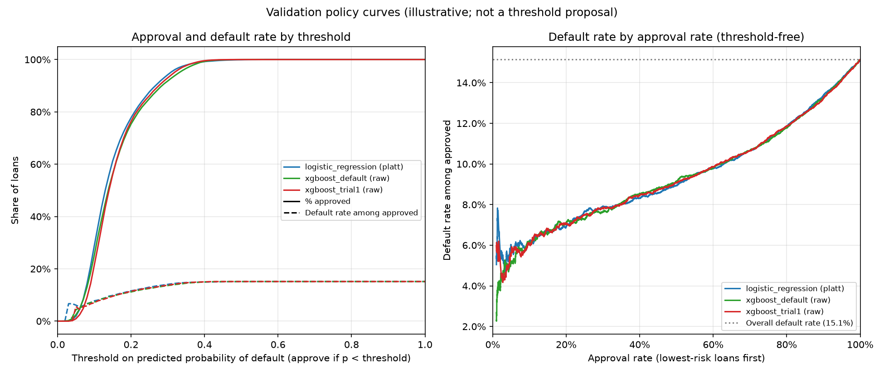

# Tabular Candidate Comparison and Calibration Report

**Document status:** Evidence record for G3 (candidate model)
**Date:** 12 October 2026
**Accountable owner:** Evan (Tabular Track Tech Lead)
**Primary author:** Brandon (Tabular Analyst)
**Experiment ID:** `TAB-20261012-001-candidate-calibration`
**Dataset version:** `kaggle-adarshsng-local-2026-09-09`
**Split version:** `split-v1` · **Cohort:** `real_text_matured_v1`
**Feature set version:** `tabular_features_v1` (D-016) · **Development roles:** `tabular_development_v1`
**Calibration config:** `tabular_calibration_v1` (decision rule committed in `ff89e75`, before the run)
**Candidates:** `tabular-logistic-v1-model-fit`, `tabular-xgboost-v1-default`, `tabular-xgboost-v1-trial1`

## 1. Purpose

This report calibrates the three shortlisted tabular candidates and compares them on the same
validation loans. For each candidate it:
- fits Platt scaling and isotonic regression on the calibration rows;
- grades raw, Platt and isotonic probabilities on validation (ROC-AUC, PR-AUC, Brier score,
  log loss, calibration plots);
- shows approval rate against default rate among approved loans;
- applies a decision rule, fixed before the run, to choose a calibration method and a champion.

The findings are summarised in section 7.

## 2. Inputs and what was fit on what

| Rows | Count (defaults) | Used for |
|---|---:|---|
| `model_fit` (Jun 2007 – Dec 2012) | 59,353 | Fitting each candidate (Allan) |
| `calibration` (Jan – Jul 2013) | 26,940 (4,090) | Fitting the Platt and isotonic calibrators only |
| `validation` (Aug – Dec 2013) | 21,784 (3,298) | Grading and the decision rule; nothing fit |
| `test` (Jan – Mar 2014) | 14,922 | Not read |

Inputs are Allan's raw predictions in `reports/tabular/raw_predictions/` (commit `b6bd0f6`).
They pass his `test_raw_predictions.py` checks: coverage, split, model version, and raw
metrics against his manifest. Outcomes were joined from the split manifest by `loan_id`; the
raw CSV was not read. 4,090 calibration defaults is an adequate sample for isotonic regression.

- **Platt:** `sigmoid(a · logit(p) + b)`, unpenalised (`C=np.inf`); the input is clipped to [1e-6, 1 − 1e-6].
- **Isotonic:** a non-decreasing step function, with its output clipped to [1e-6, 1 − 1e-6].

## 3. Results (validation, 21,784 loans, 3,298 defaults)

| Candidate | Method | Mean p | ROC-AUC | PR-AUC | Brier | Log loss |
|---|---|---:|---:|---:|---:|---:|
| logistic_regression | raw | 0.4829 | 0.6660 | 0.2575 | 0.2363 | 0.6666 |
| logistic_regression | **platt** ✓ | 0.1510 | 0.6660 | 0.2575 | 0.1225 | 0.4031 |
| logistic_regression | isotonic | 0.1511 | 0.6647 | 0.2484 | 0.1226 | 0.4060 |
| xgboost_default | **raw** ✓ | 0.1590 | 0.6660 | 0.2564 | 0.1225 | 0.4029 |
| xgboost_default | platt | 0.1509 | 0.6660 | 0.2564 | 0.1224 | 0.4027 |
| xgboost_default | isotonic | 0.1510 | 0.6659 | 0.2507 | 0.1224 | 0.4028 |
| xgboost_trial1 | **raw** ✓ | 0.1595 | 0.6661 | 0.2584 | 0.1224 | 0.4030 |
| xgboost_trial1 | platt | 0.1512 | 0.6661 | 0.2584 | 0.1223 | 0.4026 |
| xgboost_trial1 | isotonic | 0.1511 | 0.6654 | 0.2534 | 0.1224 | 0.4030 |

- **Mean p** is the average predicted probability of default. Compare it with the observed
  default rate of 0.1514.
- **✓** marks the method chosen by rule 1 (section 6).
- **Constant-rate baseline:** Brier 0.1285, log loss 0.425.
- Full results, including calibration-row metrics, are in `calibration_results.csv`.

**Checks that behaved as expected:**
- **Platt leaves ROC-AUC and PR-AUC exactly unchanged**, because it is strictly increasing.
- **Isotonic lowers PR-AUC by 0.005–0.009**, because its 34–42 steps merge loans into ties.
- **Raw rows reproduce Allan's manifest exactly.**

**Platt parameters:**

| Candidate | Slope `a` | Intercept `b` |
|---|---:|---:|
| logistic_regression | 0.99 | −1.77 |
| xgboost_default | 0.98 | −0.09 |
| xgboost_trial1 | 1.07 | +0.05 |

- **Logistic regression** has a slope of about 1 and a large negative intercept: a pure shift
  in log-odds. That is close to the shift balanced weighting predicts, −ln(n₀/n₁) ≈ −1.71 at the
  model-fit default rate of 15.3%.
- **Both XGBoost models** are close to the identity (a ≈ 1, b ≈ 0).

**Isotonic overfits slightly.** On the calibration rows it beats Platt (LR log loss 0.4029 vs
0.4043), but on validation it is worse (0.4060 vs 0.4031). Platt's log loss is about the same
on both sets.

## 4. Calibration plots



- **Logistic regression.** Raw probabilities sit far below the diagonal: predictions of
  27–73% correspond to observed default rates of 6–31%. Platt and isotonic both lie on the
  diagonal across the 5–35% range where almost all loans fall.



- **Selected XGBoost.** All three versions lie on the diagonal. The raw version sits slightly
  to the right of it: on average it overstates risk by 0.8 percentage points.

`calibration_xgboost_default.png` looks the same as the selected XGBoost plot.

## 5. Policy curve (illustrative, not a threshold proposal)



**Threshold-free comparison** (right panel): default rate among the lowest-risk loans at a
given approval rate. Each cell shows the rate and its count.

| Approval rate (loans) | LR + Platt | XGB default (raw) | XGB trial 1 (raw) |
|---|---:|---:|---:|
| 50% (10,892) | 8.95% (975) | 9.15% (997) | 9.07% (988) |
| 70% (15,249) | 10.66% (1,625) | 10.66% (1,625) | 10.66% (1,625) |
| 80% (17,427) | 11.84% (2,063) | 11.78% (2,053) | 11.87% (2,068) |
| 90% (19,606) | 13.37% (2,621) | 13.24% (2,596) | 13.24% (2,596) |

**LR + Platt at illustrative thresholds**, approve if p < t:

| Threshold `t` | Approved | Approval rate | Defaults among approved | Default rate |
|---:|---:|---:|---:|---:|
| 0.10 | 6,272 | 28.8% | 487 | 7.8% |
| 0.15 | 13,331 | 61.2% | 1,310 | 9.8% |
| 0.20 | 16,933 | 77.7% | 1,962 | 11.6% |
| 0.25 | 19,091 | 87.6% | 2,481 | 13.0% |

**A threshold means different things for different models.** At t = 0.15 the raw selected
XGBoost approves 55.9% of loans, not 61.2%, because its raw probabilities run slightly high.
Thresholds are not interchangeable across models or calibrations.

**Choosing a threshold is a separate, versioned decision.** It needs expected-loss scenarios,
and it is never optimised for accuracy or F1. Full grid: `policy_curve.csv`.

## 6. Paired comparisons (validation, 1,000 paired bootstrap resamples, seed 42)

### 6.1 Decision rules and their reasoning

Both rules were written into `configs/tabular_calibration_v1.toml` and committed (`ff89e75`)
before any calibrated validation result existed. Validation is used to choose, so fixing the
rule in advance stops the choice from bending towards whichever result looks best. Allan's
XGBoost search followed the same principle with its 20 predeclared trials.

**How a difference is judged.** Each comparison is "version B minus version A" on the same
21,784 validation loans.
- The 95% CI comes from 1,000 paired bootstrap resamples: loans are drawn with replacement, and
  both versions are scored on the same draw.
- B is **clearly better** only if it improves on A by more than a fixed margin **and** its CI
  excludes zero.
- The margin rules out differences too small to matter. The CI rules out differences that
  could be chance.

**Rule 1: calibration method, per candidate.**
- **The rule.** Methods are ordered by complexity: raw (no parameters), then Platt (2), then
  isotonic (one value per step, 34–42 here). Start from raw. Move to the next method only if it
  is clearly better than the current choice on log loss (margin 0.002).
- **Prefer the simpler method.** Fewer fitted parameters mean less risk of overfitting the
  calibration period. A simpler mapping is also easier to explain, to serialize for serving,
  and more stable if the default rate drifts. A more complex method has to earn its place.
- **Use log loss.** Calibration is about probability quality, and ROC-AUC and PR-AUC cannot
  tell raw from Platt, because Platt keeps the ranking. Log loss penalises confident wrong
  probabilities most heavily, so it is the most sensitive to miscalibration.
- **Margin 0.002.** That is about 9% of the gap between the constant-rate baseline (0.425) and
  the models (about 0.403): small, but enough to matter in practice.

**Rule 2: champion.**
- **The rule.** The incumbent is the approved logistic regression; the challenger is Allan's
  selected XGBoost (`xgboost_trial1`), each with its rule-1 method. The challenger wins only if
  it is clearly better on log loss (margin 0.002) **or** Brier score (margin 0.0005), **and**
  it is not worse on ROC-AUC by more than 0.002. `xgboost_default` is reported for completeness
  only, because Allan's search selected trial 1.
- **The burden of proof is on the challenger.** Logistic regression is simpler, explainable
  feature by feature, and already approved (D-016). Replacing it needs a measurable gain, not a
  tie.
- **Probability quality decides.** The product uses the probabilities themselves, for risk
  thresholds and expected loss, so log loss and Brier score decide.
- **The ROC-AUC guard** stops a better-calibrated model from winning while ranking loans worse.
- **Margins:** ROC-AUC and PR-AUC 0.002, the same tolerance as Allan's search. Brier 0.0005,
  about 8% of the gap between the constant-rate baseline (0.1285) and the models (about 0.122).

### 6.2 Rule 1 results (log loss, margin 0.002)

| Candidate | Comparison | Δ log loss | 95% CI | Clearly better? |
|---|---|---:|---|---|
| logistic_regression | platt − raw | −0.2635 | (−0.2721, −0.2554) | Yes |
| logistic_regression | isotonic − platt | +0.0030 | (+0.0011, +0.0052) | No (worse) |
| xgboost_default | platt − raw | −0.0002 | (−0.0005, +0.0001) | No |
| xgboost_default | isotonic − raw | −0.0001 | (−0.0006, +0.0004) | No |
| xgboost_trial1 | platt − raw | −0.0004 | (−0.0008, −0.00003) | No (below margin) |
| xgboost_trial1 | isotonic − raw | −0.0001 | (−0.0007, +0.0005) | No |

The `xgboost_trial1` Platt row shows why the margin matters. The improvement is
statistically detectable (its CI excludes zero), but at 0.0004 it is too small to justify
adding a calibrator.

### 6.3 Rule 2 results

`xgboost_trial1` (raw) − `logistic_regression` (Platt):

| Metric | Δ | 95% CI | Margin | Clearly better? |
|---|---:|---|---:|---|
| ROC-AUC | +0.0001 | (−0.0024, +0.0026) | 0.002 | No |
| PR-AUC | +0.0008 | (−0.0037, +0.0053) | 0.002 | No |
| Brier | −0.0001 | (−0.0003, +0.0002) | 0.0005 | No |
| Log loss | −0.00003 | (−0.0008, +0.0008) | 0.002 | No |

Every CI contains zero. The challenger is not worse on ROC-AUC, but it is not clearly better on
log loss or Brier score either, so the rule keeps the incumbent.

## 7. Summary

- **Calibration is needed for logistic regression only.**
  - Logistic regression: Platt brings the average predicted probability from 48.3% to 15.1%
    (observed 15.1%) and cuts validation log loss from 0.667 to 0.403. It does this without
    changing the ranking.
  - Isotonic was slightly worse than Platt on validation, so Platt is chosen.
  - Both XGBoost models are already close to calibrated (+0.8 percentage points on average),
    and no method improves them by the margin.
- **After calibration, the models are statistically comparable on the current evidence.**
  - Validation ROC-AUC 0.6660–0.6661, PR-AUC 0.256–0.258, Brier 0.1224–0.1225, log loss
    0.4029–0.4031 for the chosen versions.
  - Every paired 95% CI between the selected XGBoost and logistic regression contains zero.
  - Default rates among approved loans agree to within about 0.2 percentage points at 50–90%
    approval.
- **Under the predeclared rule, logistic regression + Platt stays the default choice**
  (`tabular-logistic-v1-model-fit`, slope 0.99, intercept −1.77). It is simpler, explainable
  and already approved. This reflects the lack of a measurable difference, not a demonstrated
  advantage over XGBoost.
- **The results are consistent with Allan's model-fit cross-validation**, where XGBoost also
  showed no ranking gain (CV ROC-AUC 0.6617 vs 0.6629). Validation ROC-AUC (0.666) shows no
  sign that the models degrade on 2013-H2 loans.

## 8. Test-set non-access

`test_rows_available_to_model = 0` in `calibration_metrics.json`. The test split was never
requested, and no test ID or label was read. Calibrators were fit only on calibration-role rows.
Validation outcomes never reached a fit; `test_tabular_calibrate.py` checks this by shuffling
the validation labels.

## 9. Limitations

- **Validation was used to choose the methods and the champion.** The chosen model's
  validation numbers are therefore slightly optimistic; the locked test set removes that bias
  at the final gate.
- **The CIs are probably somewhat narrow.** The bootstrap resamples loans independently, but
  validation loans are clustered in time. This is the same caveat as Allan's report.
- **The calibrator only fits the model_fit-trained model.** It matches a logistic regression
  fit on `model_fit` rows only. If production refits on all 86,293 train rows (still open from
  the development-roles PR), it needs a new calibrator.
- **Raw XGBoost overstates risk by about 0.8 percentage points (5% relative).** The rule kept
  raw because Platt's log-loss gain (0.0004) is below the margin. If XGBoost is ever deployed,
  Platt is worth applying for the average level alone.
- **Calibration-shift sensitivity was not studied** beyond the gap between the calibration
  period (Jan–Jul 2013) and validation (Aug–Dec 2013).
- **The environment differs slightly from Allan's.** This run used Python 3.13.9 against his
  3.13.15, with identical package pins. Nothing was refit, and a full rerun reproduces the
  committed outputs exactly.
- **Not covered here:**
  - expected-loss scenarios and a refer band;
  - subgroup and fairness checks (G4);
  - a serialized calibrator and latency (G5);
  - calibrated score files for fusion.

## Reproduce (repository root)

```
python -m pytest src/tabular/test_raw_predictions.py -q    # Allan's input checks
python -m src.tabular.calibrate                            # about 90 seconds
$env:CALIBRATION_RECOMPUTE = "1"; python -m pytest src/tabular/test_tabular_calibrate.py -q
```
